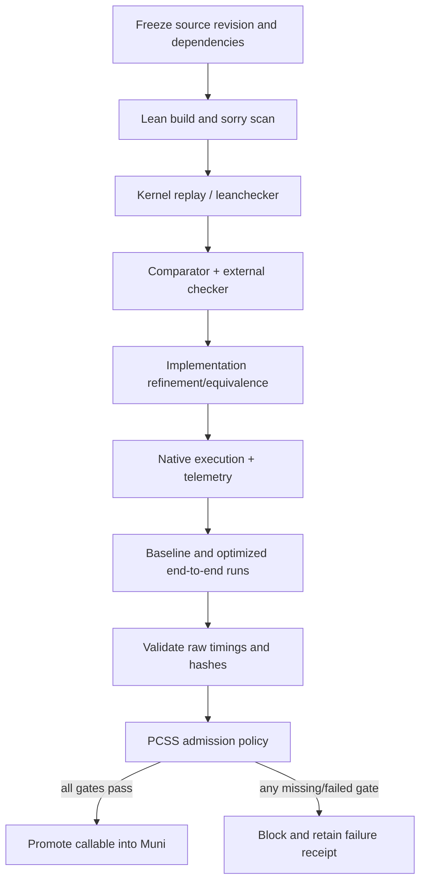

# PCSS Proof-Carrying Speedup Chain

## Purpose
PCSS makes a speedup a proof-carrying, provenance-bound claim. It does not promote a number merely because a kernel benchmark or theorem passes.

## Workflow

## Checker selection
Use the project-pinned Lean toolchain first. Since Lean 4.28+, the built-in `leanchecker` is shipped with Lean; the separate `lean4checker` repository is deprecated. The normal workflow runs `lake build` and `lake env leanchecker --fresh` on named proof modules. For high-assurance claims, configure `lake comparator` with a trusted challenge module, explicit theorem names, and an explicit permitted-axiom policy; enable independent external checkers such as nanoda when compatible with the pinned toolchain. Comparator availability is recorded and is not silently treated as a pass.

## Evidence and promotion
Each speedup receipt binds:
- exact source revision and clean/dirty status;
- toolchain and dependency manifest hashes;
- theorem IDs, theorem-manifest hash, build and checker status;
- implementation/build hash and refinement evidence;
- runtime device class, environment and telemetry hashes;
- raw baseline and optimized end-to-end timings, workload ID, and cost-accounting completeness;
- individual `S_i`, composed `S_composed`, and cumulative `S_cumulative` as distinct fields;
- claim strength, evidence strength, block reasons, and receipt hash.

The promotion evaluator requires formal build, kernel replay, independent checker, implementation equivalence, live runtime, telemetry, complete end-to-end accounting, and consistency between the reported ratio and raw timing values. Missing evidence blocks promotion. It also enforces `ClaimStrength <= EvidenceStrength`.

## Incremental work and safe reuse
Reuse prior evidence only when source, toolchain, dependency, theorem, implementation and environment identities match the manifest. Recompute the dependency closure of changed inputs. A theorem or root invariant change invalidates all dependent proof and performance receipts. A benchmark-only change need not rebuild unrelated theorem modules, but must rerun the affected accounting and claim validation.

## Speedup normalization
`S_i`: individually measured primitive.
`S_composed`: measured ratio for the actual composed implementation, never the product of component ratios.
`S_cumulative`: measured baseline-to-current end-to-end ratio for the complete stack.
Keep ideal/structural, measured, formal, independently checked, and cumulative verified values distinct. No universal or cross-device guarantee follows from one hardware run.

## Current limitation
This workflow provides the formal and evidence-contract gates. The independent comparator lane must be configured and observed passing before a claim can be promoted. A passing schema self-test is not a project proof, a silicon run, or a speedup certification.
